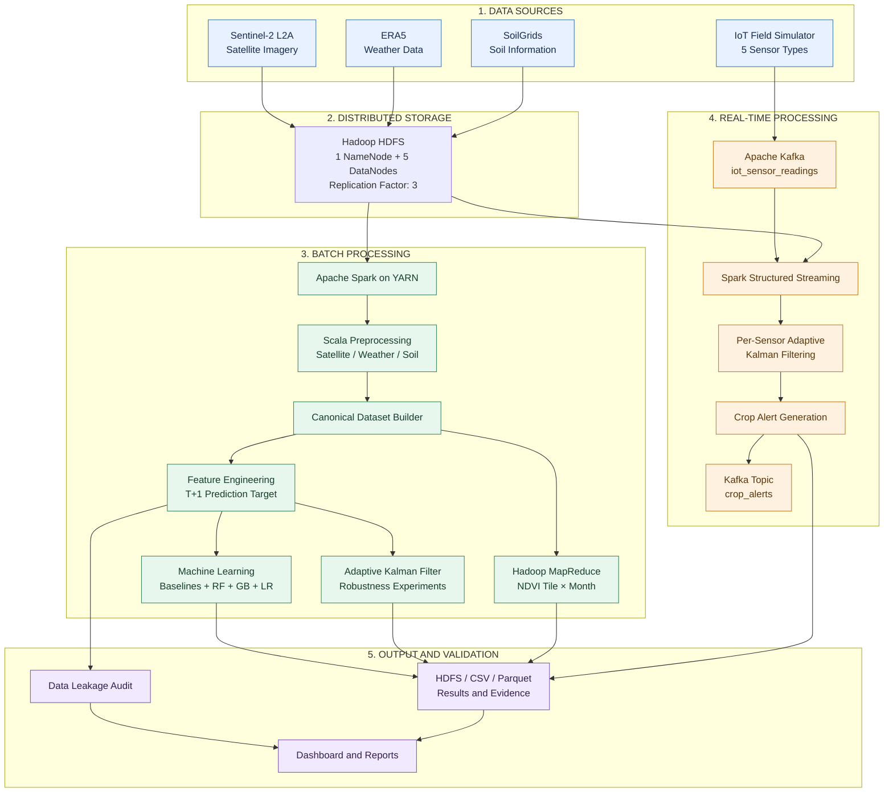
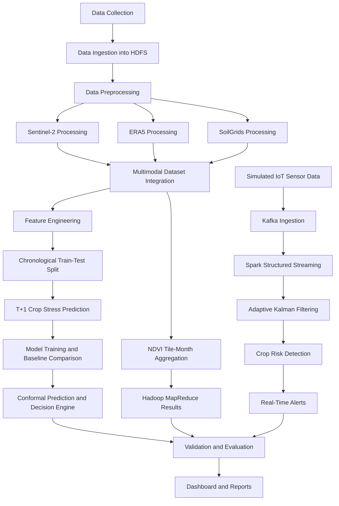

# 🌾 Smart Agriculture Big Data Platform

### End-to-end crop-stress monitoring using satellite imagery, weather data, soil information, and simulated IoT streams.

[](https://www.scala-lang.org/)
[](https://spark.apache.org/)
[](https://hadoop.apache.org/)
[](https://kafka.apache.org/)
[](https://www.docker.com/)


---

## 📌 Project Overview

Agricultural productivity is strongly influenced by environmental conditions such as vegetation health, soil properties, weather patterns, and water availability. Monitoring these factors across large geographical areas requires scalable data-processing infrastructure.

**Smart Agriculture Big Data Platform** is an end-to-end big-data engineering project designed to monitor crop stress and identify potential agricultural risks using multiple data sources.

The platform integrates Sentinel-2 satellite imagery, ERA5 weather observations, SoilGrids soil information, and simulated IoT sensor streams. It processes these datasets using a Dockerized Hadoop ecosystem, Apache Spark, Hadoop MapReduce, and Apache Kafka, with Scala used throughout the processing pipeline.

The system covers batch data processing, geospatial feature engineering, machine-learning experiments, real-time stream processing, and crop-alert generation.

### Key Highlights

| Component | Project Achievement |
|---|---|
| Satellite data | 41 Sentinel-2 L2A products |
| Raw data volume | Approximately 47 GB |
| Distributed storage | 1 NameNode + 5 DataNodes |
| Data replication | HDFS replication factor of 3 |
| Processed observations | 393,340-row multimodal dataset |
| Satellite processing | NDVI calculation over approximately 1.21 billion pixels |
| Weather data | 29,565 daily observations |
| Soil data | 19,916 soil profiles |
| Automated testing | 246 tests across 30 suites |
| Data leakage validation | 23 automated checks |
| Stream processing | Kafka + Spark Structured Streaming |

---

## 🏗️ System Architecture

The platform follows a multi-stage architecture that combines distributed batch processing with real-time stream processing.

### Architecture Diagram



### Technology Stack

| Technology | Role |
|---|---|
| Scala 2.12 | Core implementation language |
| Apache Hadoop 3.2.1 | HDFS, YARN and MapReduce |
| Apache Spark 3.5 | Distributed processing, SQL and MLlib |
| Apache Kafka 3.8 | Real-time message ingestion |
| Spark Structured Streaming | Continuous stream processing |
| Docker Compose | Multi-service cluster deployment |
| sbt | Scala build and dependency management |
| Parquet | Processed data storage format |

---

## 🔬 Methodology

The project is implemented through a sequence of data-engineering and analytical stages.

### Methodology Diagram



### 1. Data Collection and Ingestion

The platform combines three environmental datasets with simulated IoT sensor readings.

| Dataset | Purpose |
|---|---|
| Sentinel-2 L2A | Satellite imagery for vegetation and crop-condition analysis |
| ERA5 | Weather observations and derived environmental features |
| SoilGrids | Soil properties and texture information |
| Simulated IoT | Sensor readings for real-time field-condition monitoring |

The satellite, weather, and soil datasets are ingested into HDFS for distributed storage and processing.

### 2. Distributed Data Preprocessing

Scala-based Spark jobs process the different data sources.

**Sentinel-2 processing**
- Selective extraction of satellite image bands from compressed archives stored in HDFS.
- JPEG2000 image decoding.
- Radiometric correction.
- Cloud, shadow, and water masking.
- NDVI calculation.
- Aggregation into a 100 × 100 spatial grid.
- UTM-to-WGS84 georeferencing and quality filtering.

**ERA5 processing**
- NetCDF4/HDF5 data decoding.
- CF time handling and validation.
- Daily weather aggregation.
- Derived wind speed, relative humidity, and vapour pressure deficit (VPD).

**SoilGrids processing**
- GeoTIFF decoding.
- Spatial resampling.
- Missing-value handling and gap-filling.
- Soil texture normalization.
- USDA soil texture classification.

The processed datasets are stored in Parquet format.

### 3. Multimodal Dataset Integration

The processed satellite, weather, and soil observations are combined into a canonical historical dataset.

Reported outputs:

| Dataset | Observations |
|---|---:|
| NDVI cell observations | 393,340 |
| Daily weather observations | 29,565 |
| Soil profiles | 19,916 |

The integrated dataset provides a common foundation for feature engineering and downstream analytics.

### 4. Hadoop MapReduce Processing

A dedicated Hadoop MapReduce job performs NDVI aggregation by satellite tile and month.

The `NdviTileMonthDriver` processes the spatial and temporal observations to generate tile-level monthly NDVI summaries.

This demonstrates the use of both Spark-based distributed processing and traditional Hadoop MapReduce within the same platform.

### 5. Machine Learning and Crop-Stress Prediction

The machine-learning pipeline predicts crop stress at the next satellite observation.

**Prediction design**

- Target: crop stress at the next observation (T+1).
- Features: information available at the current observation (T).
- Data split: chronological rather than random.
- Cut-off date: 2024-04-07.

**Models evaluated**

- Random Forest
- Gradient Boosting
- Logistic Regression
- Naive persistence baseline
- Majority-class baseline

The models are evaluated using accuracy, ROC-AUC, and balanced accuracy.

The evaluation also includes split conformal prediction and a decision engine for communicating prediction uncertainty and investigation priority.

### 6. Adaptive Kalman Filtering

An adaptive Kalman filtering approach is implemented to handle unreliable sensor readings.

The measurement noise is adjusted using observable sensor reliability:

`R_t = R_base / max(reliability_t, ε)`

The reliability estimate uses physical bounds and deviations from recent history rather than ground-truth labels.

The implementation is evaluated under multiple simulated conditions, including:
- Outlier noise.
- Sensor bias.
- Mixed faults.
- Missing observations.
- Clean sensor readings.

An ablation experiment examines the contribution of the filtering components.

### 7. Real-Time IoT Stream Processing

The platform includes a simulated agricultural sensor network with five sensor types.

The processing pipeline is:

`IoTFieldSimulator → Kafka → Spark Structured Streaming → Kalman Filter → Crop Alerts`

- Sensor readings are published to the `iot_sensor_readings` Kafka topic.
- Spark Structured Streaming processes incoming messages.
- Per-sensor adaptive Kalman filtering is applied.
- Satellite stress probabilities and soil context are incorporated.
- Crop alerts are generated and published to `crop_alerts`.
- Results are also persisted for downstream analysis.

**Important:** IoT readings are simulated, not collected from deployed physical devices.

### 8. Validation, Audit and Dashboard

The final stage validates the pipeline and generates reports.

- Automated data-leakage audit.
- Temporal and train-only validation checks.
- Positive controls to verify that planted violations are detected.
- HDFS and YARN evidence collection.
- CSV and Parquet result generation.
- HTML dashboard generation.

---

## 📊 Results and Evaluation

The following values are reported by the project's experiments.

### 1. Adaptive Kalman Filter Evaluation

Monte Carlo experiment: 2,000 series × 11 scenarios × 4 variants.

| Scenario | Static RMSE | Adaptive RMSE | Change |
|---|---:|---:|---:|
| Outliers – 5% | 0.042 | 0.018 | -58% |
| Outliers – 10% | 0.061 | 0.025 | -58% |
| Outliers – 15% | 0.075 | 0.035 | -54% |
| Outliers – 20% | 0.087 | 0.046 | -47% |
| Bias – 10% | 0.025 | 0.019 | -26% |
| Bias – 20% | 0.039 | 0.030 | -22% |
| Mixed faults | 0.066 | 0.036 | -46% |
| Clean data | 0.0108 | 0.0124 | +15% worse |
| Missing – 10% | 0.0122 | 0.0137 | +13% worse |
| Missing – 20% | 0.0137 | 0.0151 | +10% worse |

**Interpretation:** Adaptive filtering improves performance in several noisy and faulty-data scenarios. However, it performs worse on clean and missing-data scenarios. The experiments indicate that the deviation-based adaptation should be enabled selectively for streams known to contain faults.

### 2. Next-Observation Crop-Stress Prediction

Test-period evaluation:

| Model | Accuracy | ROC-AUC | Balanced Accuracy |
|---|---:|---:|---:|
| Naive persistence | 0.701 | 0.765 | 0.661 |
| Random Forest + current-anomaly feature | 0.696 | 0.727 | 0.653 |
| Gradient Boosting | 0.675 | 0.675 | 0.625 |
| Logistic Regression | 0.639 | 0.707 | 0.500 |
| Majority Class | 0.361 | 0.500 | 0.500 |

**Important finding:** None of the learned models outperformed the naive persistence baseline on the reported test period.

This result is retained intentionally rather than presenting only favorable metrics. The difference between validation ROC-AUC (0.894) and test ROC-AUC (0.675) indicates temporal distribution shift. The stressed observation rate also changed from 70% in the fit period to 36% in the test period.

The reported conformal coverage was 80.7%, below the intended 90% target.

### 3. Streaming Detection Results

Evaluation against the simulator's hidden conditions:

| Detection Category | Detected |
|---|---:|
| Drying fields | 32 / 33 |
| Fungal-risk fields | 26 / 26 |
| False alarms | 0 / 141 |

These are simulator-based results and should not be interpreted as validated real-world agricultural detection performance.

### 4. Infrastructure Validation

| Validation | Reported Result |
|---|---|
| Unit tests | 246 / 246 passing |
| Test suites | 30 |
| Automated leakage checks | 23 / 23 passing |
| HDFS status | HEALTHY |
| DataNodes | 5 live |
| HDFS blocks | 2,456 |
| Under-replicated blocks | 0 |

---

## 🖥️ Cluster Evidence and Screenshots

The repository contains evidence collected from the deployed Dockerized Hadoop environment.

### Hadoop NameNode and DataNodes


### HDFS Raw Satellite Data


Additional evidence is available under:

`docs/evidence/`

This directory includes:
- HDFS DataNode reports.
- HDFS filesystem health checks.
- Raw and processed storage reports.
- YARN application information.
- Kafka topic information.
- Stage execution logs.
- UI screenshots.

---

## ⚙️ Installation and Quick Start

### Prerequisites

- Docker Desktop or Docker Engine with Docker Compose.
- Git Bash, WSL, Linux, or macOS terminal.
- Recommended: approximately 16 GB of WSL memory.
- Sufficient disk space for the raw datasets, intermediate files, and Docker volumes.

### 1. Clone the Repository

```bash
git clone https://github.com/navaddip/Smart-Agriculture-Big-Data.git

cd Smart-Agriculture-Big-Data
```

### 2. Prepare the Input Datasets

Place the downloaded datasets in the following directories:

```text
data/
├── sentinel2/
│   └── *.zip
├── era5/
│   └── *.zip
└── soilgrids/
    └── *.tif
```

The pipeline expects the input data in these locations. The raw datasets are not reproduced in this README; obtain the corresponding source files before running the complete pipeline.

### 3. Build the Scala Application

```bash
docker run --rm \
  -v "$PWD/scala-ingestion:/app" \
  -v sbt_cache:/root/.cache \
  -v sbt_ivy:/root/.ivy2 \
  -v sbt_home:/root/.sbt \
  -w /app \
  sbtscala/scala-sbt:eclipse-temurin-17.0.20_8_1.13.0_2.12.21 \
  sbt -batch assembly
```

### 4. Start the Hadoop and Kafka Cluster

```bash
docker compose up -d
```

### 5. Execute the Complete Pipeline

```bash
bash scripts/run_pipeline.sh
```

The pipeline is resumable: stages with existing HDFS outputs can be skipped. Use `FORCE=1` when a stage needs to be rerun.

### 6. Run Tests

```bash
cd scala-ingestion
sbt test
```

### 7. Generate UI Evidence (Optional)

From PowerShell:

```powershell
powershell -ExecutionPolicy Bypass -File scripts/capture_screenshots.ps1
```

### Expected Runtime

The reported full pipeline runtime is approximately 20 minutes, excluding the initial upload of approximately 47 GB of raw data, which took around 37 minutes in the reported environment. Actual runtime depends on hardware, disk performance, and data availability.

---

## 🌐 Monitoring and Web Interfaces

Once the services are running, the following interfaces can be accessed locally:

| Service | URL |
|---|---|
| Hadoop NameNode | http://localhost:9870 |
| YARN ResourceManager | http://localhost:8088 |
| Spark History Server | http://localhost:18080 |
| Generated HTML Dashboard | `results/dashboard/index.html` |

---

## 🔄 Pipeline Execution Stages

| Stage | Operation | Execution Environment |
|---|---|---|
| 00 | Cluster health check | HDFS |
| 01 | Raw data upload | HDFS |
| 02–04 | Sentinel-2, ERA5 and SoilGrids preprocessing | Spark on YARN |
| 05 | Canonical multimodal dataset construction | Spark on YARN |
| 06 | NDVI tile × month aggregation | Hadoop MapReduce |
| 07 | Feature engineering and T+1 target generation | Spark on YARN |
| 08 | Kalman robustness and ablation experiments | Spark |
| 09 | Models, baselines, conformal prediction and decisions | Spark MLlib |
| 10 | Automated leakage audit | JVM |
| 11 | IoT simulation, Kafka and streaming alerts | Kafka + Spark Streaming |
| 12 | HDFS and YARN evidence collection | HDFS / YARN |
| 13 | Dashboard generation | JVM |

---

## 📁 Repository Structure

```text
Smart-Agriculture-Big-Data/
│
├── docker-compose.yml
├── hadoop.env
│
├── cluster/
│   ├── Hadoop client configuration
│   └── Spark configuration
│
├── scala-ingestion/
│   ├── src/main/scala/
│   │   └── smartagri/
│   │       ├── preprocess/
│   │       ├── canonical/
│   │       ├── mapreduce/
│   │       ├── features/
│   │       ├── kalman/
│   │       ├── ml/
│   │       ├── conformal/
│   │       ├── decision/
│   │       ├── iot/
│   │       ├── kafka/
│   │       ├── streaming/
│   │       ├── audit/
│   │       └── report/
│   │
│   └── src/test/
│
├── scripts/
│   ├── run_pipeline.sh
│   ├── hdfs_load_raw.sh
│   ├── submit.sh
│   └── capture_screenshots.ps1
│
├── data/
│   ├── sentinel2/
│   ├── era5/
│   └── soilgrids/
│
├── processed/
│
├── results/
│   ├── experiments/
│   └── dashboard/
│
├── docs/
│   └── evidence/
│       └── screenshots/
│
└── legacy/
```

---

## ⚠️ Limitations and Future Improvements

The project includes several known limitations that define the next development steps.

| Limitation | Current Situation | Future Improvement |
|---|---|---|
| Weather coverage | ERA5 data covers 2023 only; weather features are constant in the 2024 ML rows | Add additional ERA5 observations |
| Soil coverage | SoilGrids and ERA5 coverage stops at longitude 78.0°, while tile T43PHQ extends to 78.76° | Extend spatial coverage to longitude 79° |
| IoT hardware | Sensor data is simulated | Integrate physical field sensors |
| Cluster deployment | All cluster services run on a single host | Deploy across multiple physical or cloud nodes |
| Temporal generalization | Training uses only four fit dates | Expand the historical training period |
| Model performance | Learned models do not outperform naive persistence on the reported test data | Improve features, temporal coverage and generalization |

**Reproducibility note:** The project reports a real distributed Hadoop service configuration, but all cluster nodes run on a single host. HDFS replication is configured, but this does not provide physical machine-level fault tolerance.

---

## 🚀 Future Scope

- Integrate real IoT devices and field sensor networks.
- Expand satellite imagery and historical weather coverage.
- Improve temporal generalization of crop-stress prediction models.
- Evaluate additional geospatial and time-series forecasting methods.
- Deploy the cluster across multiple machines or cloud infrastructure.
- Extend crop-risk monitoring to additional geographical regions.
- Improve the dashboard with interactive geospatial visualizations.

---

## 👨‍💻 Author

**Navaddip Chowdary**

B.Tech – Computer Science and Engineering (Artificial Intelligence)  
Amrita Vishwa Vidyapeetham

[](https://github.com/navaddip)

**GitHub:** [github.com/navaddip](https://github.com/navaddip)

---

## ⭐ Project Summary

Smart Agriculture Big Data Platform demonstrates how distributed data engineering, geospatial processing, machine learning, and real-time stream processing can be combined into a unified agricultural monitoring pipeline.

The project emphasizes scalable data processing, reproducible experiments, infrastructure validation, and transparent reporting of model performance and system limitations.

**Built with Scala, Apache Hadoop, Apache Spark, Apache Kafka, and Docker.**
