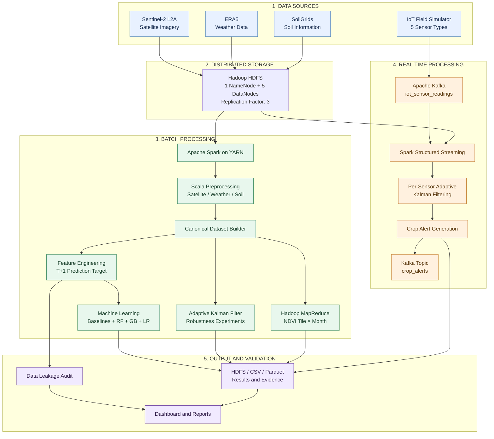
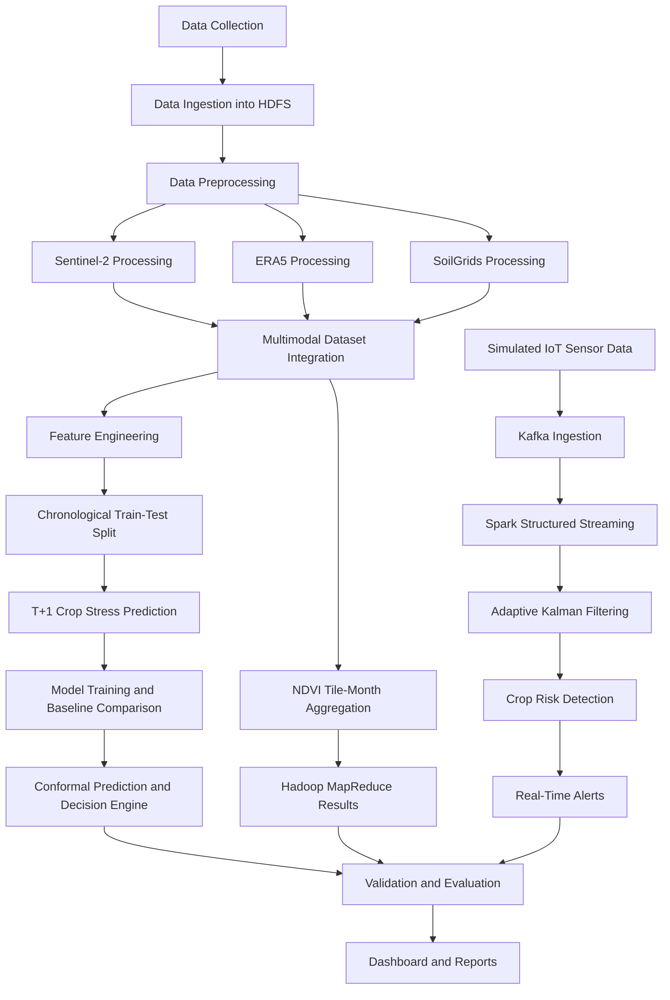
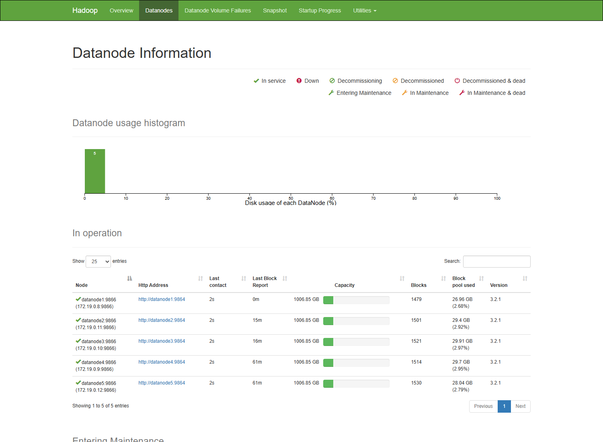
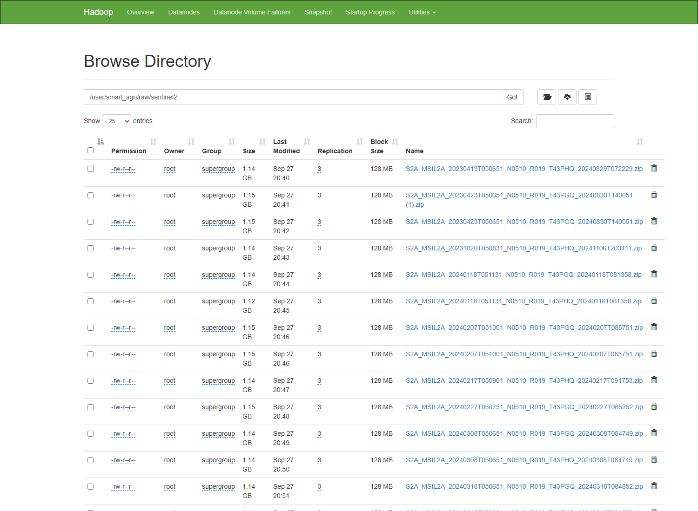

# 🌾 Smart Agriculture Big Data Platform

### End-to-end crop-stress monitoring from satellite imagery, weather data, soil information and IoT streams, built in Scala on a Dockerised Hadoop / Spark / Kafka cluster.

[](https://www.scala-lang.org/)
[](https://spark.apache.org/)
[](https://hadoop.apache.org/)
[](https://kafka.apache.org/)
[](https://www.docker.com/)


---

## 📌 Overview

Crop health depends on vegetation condition, soil, weather and water availability. Monitoring these over large areas needs scalable data infrastructure.

This project is an end-to-end big-data pipeline that monitors crop stress for two Sentinel-2 tiles near Bengaluru (T43PGQ, T43PHQ). It combines **Sentinel-2 satellite imagery, ERA5 weather, SoilGrids soil data and simulated IoT sensor streams**, and processes them with **Scala on Apache Spark, Hadoop MapReduce and Kafka**. Raw and processed data live in HDFS on a Dockerised cluster.

It covers batch processing, geospatial feature engineering, machine-learning experiments, real-time stream processing and crop-alert generation.

### At a glance

| Component | Result |
|---|---|
| Satellite data | 41 Sentinel-2 L2A products, about **47 GB raw** |
| Distributed storage | 1 NameNode + **5 DataNodes**, replication factor 3 |
| Satellite processing | NDVI over about **1.21 billion pixels** |
| Processed dataset | **393,340-row** multimodal table (satellite + weather + soil) |
| Weather / soil data | 29,565 daily weather rows, 19,916 soil profiles |
| Stream processing | Kafka + Spark Structured Streaming with per-sensor Kalman filtering |
| Quality | **246 unit tests** (30 suites) and a **23-check data-leakage audit** |
| HDFS health | `fsck` HEALTHY, 2,456 blocks, 0 under-replicated |

---

## 🏗️ System Architecture



### Technology stack

| Technology | Role |
|---|---|
| Scala 2.12 + sbt | Implementation language and build tool |
| Apache Hadoop 3.2.1 | HDFS, YARN and MapReduce |
| Apache Spark 3.5 | Distributed processing, Spark SQL, MLlib, Structured Streaming |
| Apache Kafka 3.8 (KRaft) | Real-time message ingestion |
| Docker Compose | Multi-service cluster deployment |
| Parquet | Processed data format |

---

## 💡 Technical Highlights

- **Selective extraction from HDFS:** each Sentinel-2 zip is opened in place with positional reads and only the needed bands (B04, B8A, SCL) are read, so about **2.86 GB of the 47 GB** (around 6%) is actually processed.
- **Leakage-safe prediction target:** the model predicts stress at the *next* satellite observation (T+1) using only information up to T, with a chronological split and train-only thresholds.
- **Self-verifying leakage audit:** 23 automated checks (reflection on compiled types, source scans, temporal and train-only checks) plus **5 planted violations** that must be caught or the audit fails.
- **Kalman filtering on Spark:** the recursion depends on the previous output, so it cannot be a window function. It runs through `mapPartitions` with a streaming iterator that buffers one cell at a time, keeping memory bounded. In the live stream, state is kept per sensor with `flatMapGroupsWithState`.
- **Resumable pipeline:** stages whose HDFS output already exists are skipped; `FORCE=1` and `ONLY="9 11"` give fine control.

### Scale, stated honestly

| Aspect | Detail |
|---|---|
| Raw input | About 47 GB (about 141 GB on disk at replication 3) |
| Data actually read | 2.86 GB after selective extraction |
| Processed output | Tens of MB of Parquet |
| Infrastructure | 5 DataNodes and 2 NodeManagers as containers on one 32-core host |

Replication and HDFS/YARN distribution are real, but because everything runs on one machine there is no physical fault tolerance.

---

<details>
<summary><b>🔬 Methodology (click to expand)</b></summary>



### 1. Data collection and ingestion

| Dataset | Purpose |
|---|---|
| Sentinel-2 L2A | Satellite imagery for vegetation and crop-condition analysis |
| ERA5 | Weather observations and derived environmental features |
| SoilGrids | Soil properties and texture information |
| Simulated IoT | Sensor readings for real-time field-condition monitoring |

Satellite, weather and soil data are loaded into HDFS under `/user/smart_agri/raw/`.

### 2. Distributed preprocessing (25 operations, Scala on Spark, HDFS to HDFS)

**Sentinel-2**
- Product inventory, validation and de-duplication (a byte-identical duplicate zip is detected by checksum and dropped)
- Selective extraction of bands from zips stored in HDFS
- Pure-Java JPEG2000 decoding and radiometric correction
- Per-pixel cloud, shadow and water masking from the Scene Classification Layer
- NDVI calculation and aggregation to a 100 × 100 grid (about 1.1 km cells)
- UTM to WGS84 georeferencing and quality filtering (at least 30% clear land pixels per cell)

**ERA5**
- NetCDF4/HDF5 decoding with CF scale, offset and time handling
- Physical-range validation, duplicate removal and daily aggregation
- Derived wind speed, relative humidity and vapour pressure deficit (VPD)

**SoilGrids**
- GeoTIFF decoding and nodata handling
- Resampling to the cell grid with gap-filling
- Texture normalisation and USDA texture classification

### 3. Multimodal dataset integration

ERA5 is matched by nearest neighbour and exact date, and soil is joined one-to-one by cell, with validation checks.

| Dataset | Rows |
|---|---:|
| NDVI cell observations | 393,340 |
| Daily weather observations | 29,565 |
| Soil profiles | 19,916 |

### 4. Hadoop MapReduce

`NdviTileMonthDriver` aggregates NDVI by tile and month, so the platform uses both Spark and classic MapReduce.

### 5. Machine learning and crop-stress prediction

- **Target:** stress at the next observation (T+1)
- **Split:** chronological, cut-off 2024-04-07 (105,848 train / 48,747 test rows)
- **Models:** Random Forest, Gradient Boosting, Logistic Regression, with naive-persistence and majority-class baselines
- **Selection:** the primary model was chosen on a validation date inside the fit period, never on the test period
- **Uncertainty:** split conformal prediction and a decision engine that ranks fields by investigation priority

### 6. Adaptive Kalman filtering

Measurement noise is adjusted using observable reliability:

`R_t = R_base / max(reliability_t, ε)`

Reliability uses physical bounds and deviation from recent history, never ground truth. It is evaluated under outliers, bias, mixed faults, missing data and clean data, with an ablation of its components.

### 7. Real-time IoT stream processing

`IoTFieldSimulator → Kafka → Spark Structured Streaming → Kalman filter → Crop alerts`

Readings go to `iot_sensor_readings`. Each sensor gets its own adaptive filter, satellite stress probability and soil context are added, and alerts go to `crop_alerts` and HDFS. **IoT readings are simulated, not collected from physical devices.**

### 8. Validation and reporting

Automated leakage audit, HDFS/YARN evidence capture, CSV/Parquet results and an HTML dashboard.

</details>

---

## 📊 Results and Evaluation

All values come from the project's own experiments.

### 1. Adaptive Kalman filter (Monte Carlo: 2,000 series × 11 scenarios × 4 variants)

| Scenario | Static RMSE | Adaptive RMSE | Change |
|---|---:|---:|---:|
| Outliers 5% | 0.042 | 0.018 | −58% |
| Outliers 10% | 0.061 | 0.025 | −58% |
| Outliers 15% | 0.075 | 0.035 | −54% |
| Outliers 20% | 0.087 | 0.046 | −47% |
| Bias 10% | 0.025 | 0.019 | −26% |
| Bias 20% | 0.039 | 0.030 | −22% |
| Mixed faults | 0.066 | 0.036 | −46% |
| Clean data | 0.0108 | 0.0124 | +15% (worse) |
| Missing 10% | 0.0122 | 0.0137 | +13% (worse) |
| Missing 20% | 0.0137 | 0.0151 | +10% (worse) |

**Interpretation:** adaptive filtering helps a lot under outliers, bias and mixed faults, but hurts on clean and missing data. The ablation shows the physical-bounds check never hurts, while the deviation term causes both the gains and the losses. On real Sentinel-2 NDVI series the pattern repeats: −35% RMSE at 15% outliers, but +101% on clean data, because real crop NDVI changes quickly. The deviation term should be enabled only for streams known to be faulty.

### 2. Next-observation crop-stress prediction (test period)

| Model | Accuracy | ROC-AUC | Balanced Accuracy |
|---|---:|---:|---:|
| Naive persistence | 0.701 | 0.765 | 0.661 |
| Random Forest + current-anomaly feature | 0.696 | 0.727 | 0.653 |
| Gradient Boosting (chosen on validation) | 0.675 | 0.675 | 0.625 |
| Logistic Regression | 0.639 | 0.707 | 0.500 |
| Majority class | 0.361 | 0.500 | 0.500 |

**Important finding:** no learned model beats the naive persistence baseline on this data. The baseline was added deliberately to catch this, so the result is reported rather than tuned away.

Validation ROC-AUC was 0.894 against 0.675 on the test period, which indicates temporal drift: the stressed rate moved from 70% in the fit period to 36% in the test period. Split conformal coverage was 80.7% against the 90% target for the same reason. The decision engine's ordering is still sensible: fields flagged *InvestigatePriority* were stressed 55% of the time, against 22% for *LowRisk*.

### 3. Streaming detection (against the simulator's hidden conditions)

| Category | Result |
|---|---:|
| Drying fields detected | 32 / 33 |
| Fungal-risk fields detected | 26 / 26 |
| False alarms | 0 / 141 |

These are pipeline-correctness checks on simulated data with clearly separated conditions. They are not validated real-world detection performance.

### 4. Infrastructure validation

| Check | Result |
|---|---|
| Unit tests | 246 / 246 passing (30 suites) |
| Leakage audit | 23 / 23 checks passing |
| HDFS status | HEALTHY, 5 live DataNodes |
| HDFS blocks | 2,456 (0 under-replicated) |

---

## 🖥️ Cluster Evidence

### Hadoop NameNode with five live DataNodes



### Raw Sentinel-2 data in HDFS



More evidence is in `docs/evidence/`: HDFS reports (`dfsadmin`, `fsck`, `du`), YARN application list, Kafka topics, stage execution logs and 16 UI screenshots.

---

## ⚙️ Quick Start

### Prerequisites

- Docker Desktop or Docker Engine with Docker Compose
- Git Bash, WSL, Linux or macOS terminal
- About 16 GB of memory available to Docker/WSL
- Large free disk space: the raw data alone occupies about 141 GB inside HDFS at replication 3

### 1. Clone the repository

```bash
git clone https://github.com/navaddip/Smart-Agriculture-Big-Data.git
cd Smart-Agriculture-Big-Data
```

### 2. Add the input data

The raw datasets are not included in this repository. Download them and place them as follows:

```text
data/
├── sentinel2/   *.zip   (Sentinel-2 L2A products)
├── era5/        *.zip   (ERA5 downloads)
└── soilgrids/   *.tif   (SoilGrids rasters)
```

### 3. Build the Scala application

sbt runs inside Docker, so nothing else needs to be installed.

```bash
docker run --rm \
  -v "$PWD/scala-ingestion:/app" \
  -v sbt_cache:/root/.cache \
  -v sbt_ivy:/root/.ivy2 \
  -v sbt_home:/root/.sbt \
  -w /app \
  sbtscala/scala-sbt:eclipse-temurin-17.0.20_8_1.13.0_2.12.21 \
  sbt -batch assembly
```

### 4. Start the cluster

```bash
docker compose up -d
```

### 5. Run the full pipeline

```bash
bash scripts/run_pipeline.sh
```

The pipeline is resumable: stages with existing HDFS output are skipped. Use `FORCE=1` to re-run everything, or `ONLY="9 11"` to run selected stages. Each stage logs to `docs/evidence/NN_<stage>.log`.

### 6. Run the unit tests

```bash
docker run --rm \
  -v "$PWD/scala-ingestion:/app" \
  -v sbt_cache:/root/.cache \
  -v sbt_ivy:/root/.ivy2 \
  -v sbt_home:/root/.sbt \
  -w /app \
  sbtscala/scala-sbt:eclipse-temurin-17.0.20_8_1.13.0_2.12.21 \
  sbt -batch test
```

### 7. Capture UI screenshots (optional, PowerShell)

```powershell
powershell -ExecutionPolicy Bypass -File scripts/capture_screenshots.ps1
```

### Expected runtime

On the reference machine, the full pipeline took about 20 minutes, plus about 37 minutes for the one-time upload of 47 GB of raw data. Actual times depend on hardware and disk speed.

### Web interfaces

| Service | URL |
|---|---|
| Hadoop NameNode | http://localhost:9870 |
| YARN ResourceManager | http://localhost:8088 |
| Spark History Server | http://localhost:18080 |
| Running Spark job | http://localhost:4040 |
| Generated dashboard | `results/dashboard/index.html` |

---

## 🔄 Pipeline Stages

| Stage | Operation | Runs on |
|---|---|---|
| 00 | Cluster health check | HDFS |
| 01 | Raw data upload | HDFS |
| 02–04 | Sentinel-2, ERA5 and SoilGrids preprocessing | Spark on YARN |
| 05 | Canonical multimodal dataset | Spark on YARN |
| 06 | NDVI tile × month aggregation | Hadoop MapReduce on YARN |
| 07 | Leakage-safe features and T+1 target | Spark on YARN |
| 08 | Kalman robustness and ablation | Spark on YARN |
| 09 | Models, baselines, conformal prediction, decisions | Spark MLlib on YARN |
| 10 | Automated leakage audit | JVM |
| 11 | IoT simulator → Kafka → streaming alerts | Kafka + Spark Streaming |
| 12 | HDFS and YARN evidence capture | HDFS / YARN |
| 13 | Dashboard generation | JVM |

---

## 📁 Repository Structure

```text
Smart-Agriculture-Big-Data/
├── docker-compose.yml        Cluster definition (NameNode, 5 DataNodes, YARN, Kafka)
├── hadoop.env                Hadoop configuration (replication factor 3)
├── open_project_tools.bat    Windows helper script
├── cluster/                  Hadoop client and Spark configuration
├── scala-ingestion/          All Scala code (sbt)
│   ├── src/main/scala/smartagri/
│   │   ├── preprocess/       Sentinel-2, ERA5, SoilGrids preprocessing
│   │   ├── canonical/        Multimodal join and validation
│   │   ├── mapreduce/        Hadoop MapReduce job
│   │   ├── features/         Leakage-safe features, T+1 target, split
│   │   ├── kalman/           Adaptive Kalman filter and robustness experiments
│   │   ├── ml/               Models and baselines
│   │   ├── conformal/        Conformal prediction
│   │   ├── decision/         Decision engine
│   │   ├── iot/              IoT field simulator
│   │   ├── kafka/            Kafka producer
│   │   ├── streaming/        Structured Streaming job
│   │   ├── audit/            Leakage audit
│   │   └── report/           Dashboard generator
│   └── src/test/             Unit tests (246 tests, 30 suites)
├── scripts/                  run_pipeline.sh, hdfs_load_raw.sh, submit.sh, capture_screenshots.ps1
├── processed/                Processed outputs
├── results/                  CSV reports and dashboard (preprocessing, kalman, ml,
│                             streaming, leakage_audit, experiments, dashboard)
├── docs/evidence/            Stage logs, HDFS/YARN evidence, screenshots
└── legacy/                   Superseded Python / old Scala code (not built)

data/ (created locally, not included in the repository)
├── sentinel2/   era5/   soilgrids/
```

---

## ⚠️ Limitations and Roadmap

| Limitation | Current situation | Planned improvement |
|---|---|---|
| Weather coverage | ERA5 covers 2023 only, so the 9 weather features are constants in the 2024 ML rows. Model results are effectively satellite + soil. | Add more ERA5 files to `data/era5/` and re-run with `FORCE=1 ONLY="1 3 5 7 9 11 13"` |
| Spatial coverage | SoilGrids and ERA5 stop at longitude 78.0°, but tile T43PHQ extends to 78.76° (7,480 cells have no soil data) | Download both for longitude 76–79° |
| IoT data | Sensor readings are simulated | Replace the simulator with real devices publishing the same JSON to `iot_sensor_readings` |
| Cluster | All services run on a single host | Deploy across multiple machines or cloud nodes |
| Temporal generalisation | Training covers only 4 fit dates; learned models do not beat naive persistence | Longer history, better features, drift-aware methods |

Further ideas: additional regions, time-series forecasting methods and an interactive geospatial dashboard.

---

## 🧰 Skills Demonstrated

Distributed data engineering (HDFS, YARN, Spark, MapReduce) · Stream processing (Kafka, Structured Streaming) · Geospatial and remote-sensing data handling · Time-series filtering and robust estimation · Leakage-safe ML evaluation and uncertainty quantification · Test-driven Scala development · Docker-based reproducible deployment · Transparent reporting of results and limitations

---

## 👨‍💻 Author

**Navaddip Chowdary**
B.Tech, Computer Science and Engineering (Artificial Intelligence), Amrita Vishwa Vidyapeetham

[](https://github.com/navaddip)
